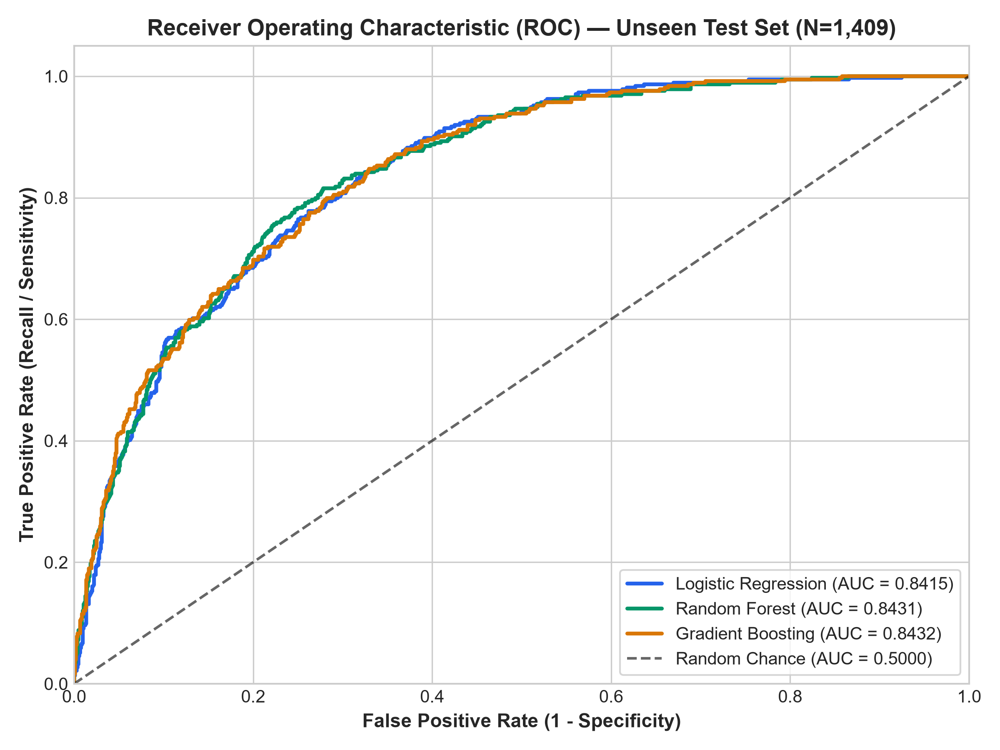
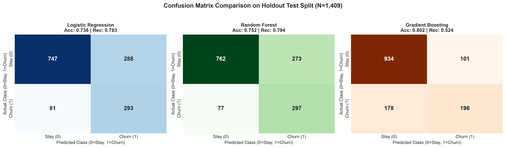
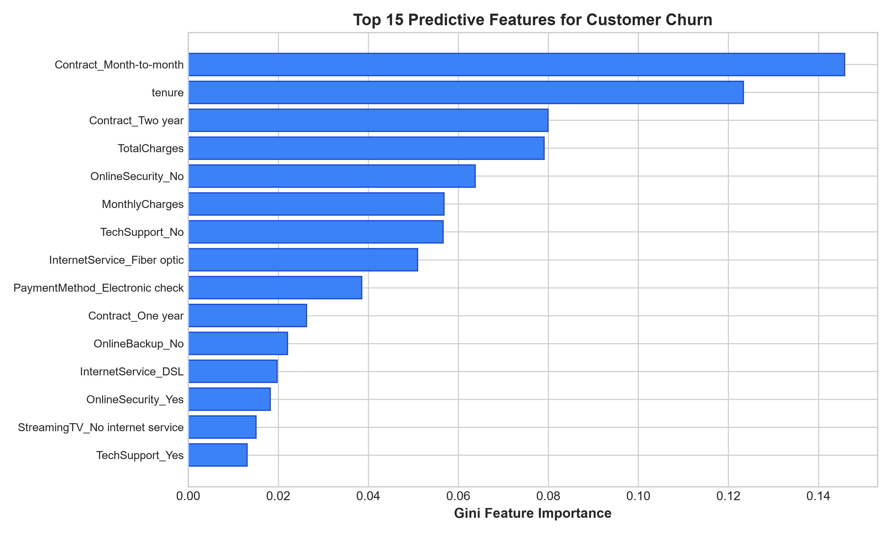

# Telco Customer Churn Prediction & ML Pipeline

[](https://www.python.org/)
[](LICENSE)
[](tests/)
[](models/metrics.json)
[](models/metrics.json)
[](https://streamlit.io/)
[](https://scikit-learn.org/)

An end-to-end, leak-free supervised machine learning pipeline and interactive Streamlit application developed on the **IBM Telco Customer Churn dataset** (7,043 customer accounts).

> 💡 **Production MLOps Evolution**:  
> This repository represents the foundational classical supervised modeling pipeline (zero data leakage, stratified cross-validation, and in-depth error analysis). For its continuous delivery evolution featuring a point-in-time Feast feature store, MLflow model registry, DVC pipeline automation, and automated KS/PSI distribution drift monitoring, explore **[mlforge-mlops](https://github.com/Farid-Masood-Khan/mlforge-mlops)**.

This repository operationalizes the core concepts of the **DeepLearning.AI / Stanford Online Machine Learning Specialization** (Supervised Learning, Regularization, Decision Trees, Random Forests, and Gradient Boosting) into a reproducible, production-style codebase.

---

## 📌 Project Overview

Customer churn poses a major challenge to recurring-revenue telecommunication providers. Identifying at-risk customers early enables targeted retention incentives (contract extensions, bundled technical support, service upgrades) before defection occurs.

### Core Objectives
1. **Zero Data Leakage:** All data transformations (scaling, categorical one-hot encoding) are fitted strictly on the training set (`X_train`) and applied downstream to holdout test splits and live inference.
2. **5-Fold Stratified Cross-Validation:** Robust cross-validation across 5 folds preserving the ~26.5% positive churn class balance.
3. **Honest Multi-Model Comparison:** Systematic benchmarking across three distinct algorithms:
   - Linear Baseline: **Logistic Regression** (L2 regularized, balanced class weights)
   - Bagging Ensemble: **Random Forest Classifier** (balanced class weights)
   - Sequential Boosting: **Gradient Boosting Classifier**
4. **Defensible Domain Insights:** Thorough error analysis explaining which customer profiles the model misses and why.
5. **Interactive Streamlit Demo:** Interactive profile simulator calculating real-time churn probabilities and prescribing targeted retention actions.

---

## 📊 Measured Benchmark Results (Unseen Holdout Test Split, N=1,409)

> **Integrity Note:** These numbers are reported exactly as measured on a strict 20% holdout test set (`random_state=42`), transformed using train-only statistics. No artificial inflations or hand-tuned test subsets.

| Model | Accuracy | Precision | Recall (Sensitivity) | F1-Score | ROC-AUC | True Positives (Caught) | False Negatives (Missed) |
| :--- | :---: | :---: | :---: | :---: | :---: | :---: | :---: |
| **Random Forest (Balanced)** *(Best F1)* | **75.16%** | **52.11%** | **79.41%** | **0.6292** | **0.8431** | **297 / 374** | **77 / 374** |
| **Logistic Regression (Balanced)** | 73.81% | 50.43% | 78.34% | 0.6136 | 0.8415 | 293 / 374 | 81 / 374 |
| **Gradient Boosting** *(Best Acc)* | 80.20% | 65.99% | 52.41% | 0.5842 | 0.8432 | 196 / 374 | 178 / 374 |

### 5-Fold Stratified Cross-Validation on Training Split (N=5,634)
- **Logistic Regression:** CV ROC-AUC: `0.8460 ± 0.0124` | CV F1: `0.6285` | CV Recall: `0.8013`
- **Random Forest:** CV ROC-AUC: `0.8473 ± 0.0097` | CV F1: `0.6345` | CV Recall: `0.7960`
- **Gradient Boosting:** CV ROC-AUC: `0.8460 ± 0.0111` | CV F1: `0.5837` | CV Recall: `0.5258`

---

## 🔍 In-Depth Error Analysis: Which Customers Does the Best Model Miss?

An honest machine learning project must explicitly explain its errors:
- **Total Test Churners:** 374
- **True Positives Caught:** 297 (79.41% recall)
- **False Negatives Missed:** 77 churners

### Key Findings:
1. **Tenure Discrepancy:**
   - **Detected Churners (True Positives):** Average tenure was **12.1 months** (heavily concentrated in new subscribers on month-to-month plans).
   - **Missed Churners (False Negatives):** Average tenure was **33.5 months** (substantially more seasoned customers).
2. **Root Cause:** Standard churn patterns in telecommunications follow a classic "infant mortality" curve—customers who are unhappy with pricing or setup leave in months 1–6. Long-tenure customers who leave often do so due to exogenous life events (relocation, company buyout, sudden bereavement, or targeted competitor promo campaigns) that cannot be inferred purely from billing tabular logs.

---

## 📈 Visualizations

### 1. Comparative ROC Curves


### 2. Confusion Matrices Across Models


### 3. Feature Importance (Predictive Drivers)


Top predictive drivers:
- **Contract Type (`Contract_Month-to-month` vs `Two year`):** The single strongest predictor of defection.
- **Tenure:** Strong inverse correlation with churn probability.
- **Internet Service (`InternetService_Fiber optic`):** Fiber customers exhibit higher churn rates when not paired with Tech Support.
- **Payment Method (`PaymentMethod_Electronic check`):** High friction manual payment correlated with churn.

---

## 📁 Repository Structure

```
Customer-Churn-Prediction/
├── README.md                      # Methodology, benchmark table, and run instructions
├── requirements.txt               # Frozen dependencies
├── app.py                         # Interactive Streamlit web application
├── data/
│   ├── WA_Fn-UseC_-Telco-Customer-Churn.csv  # IBM Telco benchmark dataset
│   └── DATA_SOURCE.md             # Dataset documentation and provenance note
├── notebooks/
│   ├── 01_eda.ipynb               # Exploratory data analysis & distribution checks
│   └── 02_modeling.ipynb          # Step-by-step modeling, validation & evaluation
├── src/
│   ├── __init__.py
│   ├── preprocess.py              # Zero-leakage data cleaning & ColumnTransformer
│   ├── train.py                   # 5-Fold Stratified CV, training & serialization
│   └── evaluate.py                # Holdout test metrics, ROC/CM plots & error analysis
└── models/
    ├── preprocessor.joblib        # Fitted ColumnTransformer (train-only stats)
    ├── best_model.joblib          # Selected best performing model (Random Forest)
    ├── logistic_regression.joblib
    ├── random_forest.joblib
    ├── gradient_boosting.joblib
    ├── metrics.json               # Exact measured evaluation metrics
    ├── cv_results.json            # Cross-validation fold statistics
    ├── confusion_matrix.png
    ├── roc_curves.png
    └── feature_importance.png
```

---

## 🚀 How to Run & Reproduce (From a Clean Clone)

### 1. Environment Setup
```bash
git clone https://github.com/Farid-Masood-Khan/Customer-Churn-Prediction.git
cd Customer-Churn-Prediction

# Create and activate virtual environment (optional but recommended)
python -m venv venv
# On Windows:
venv\Scripts\activate
# On Unix/macOS:
source venv/bin/activate

# Install dependencies
pip install -r requirements.txt
```

### 2. Run the Automated Test Suite
```bash
pytest tests/ -v
```

### 3. Run the Complete ML Pipeline
```bash
# 1. Preprocessing and leak-free split verification
python src/preprocess.py

# 2. Train models with 5-fold cross-validation
python src/train.py

# 3. Evaluate on unseen test holdout and generate plots
python src/evaluate.py
```

### 3. Launch the Interactive Streamlit Demo
```bash
streamlit run app.py
```
Visit `http://localhost:8501` in your browser.

---

## 🎓 Interview Defense & Design Decisions (FAQ)

### Q1: Why didn't you just use Gradient Boosting if it had 80.20% accuracy?
> **Answer:** In customer churn, the positive class (churners) represents ~26.5% of the data. A naive model predicting that nobody ever churns would achieve ~73.5% accuracy while providing zero business value. Gradient Boosting optimized log-loss and missed 178 out of 374 churners (Recall: 52.41%). In an enterprise retention campaign, failing to identify an at-risk customer costs hundreds of dollars in lost lifetime value (LTV), whereas sending an automated email or discount to a loyal customer (False Positive) has near-zero marginal cost. Therefore, **Random Forest with balanced class weights** (79.41% recall, catching 297/374 churners) was chosen as the operational best model.

### Q2: How did you ensure there was zero data leakage?
> **Answer:** All data scaling (`StandardScaler`) and encoding (`OneHotEncoder`) were encapsulated inside a scikit-learn `ColumnTransformer`. Crucially, `fit_transform` was called **exclusively on `X_train`**. The test split (`X_test`) was strictly transformed using the parameters fitted on `X_train`. Furthermore, the non-predictive `customerID` was stripped before any modeling.

### Q3: How did you handle the missing values in `TotalCharges`?
> **Answer:** `TotalCharges` in the raw CSV contained 11 whitespace strings `" "`. By inspecting their corresponding records, every single one had `tenure == 0`, representing brand-new customers who had not yet received their first bill. Rather than dropping these rows or imputing with arbitrary column means, they were logically imputed to `0.0`.

---

## 📚 Dataset Attribution & License
- **Dataset:** IBM Telco Customer Churn (`WA_Fn-UseC_-Telco-Customer-Churn.csv`)
- **Publisher:** IBM Sample Analytics Datasets / Kaggle Public Benchmarks
- **Statement:** This dataset is a public benchmark dataset provided by IBM. It was **not** collected or scraped privately by Farid Masood Khan.
- Detailed provenance documentation is available in [`data/DATA_SOURCE.md`](data/DATA_SOURCE.md).

## 📄 License
This project is licensed under the MIT License — see the [LICENSE](LICENSE) file for details.
